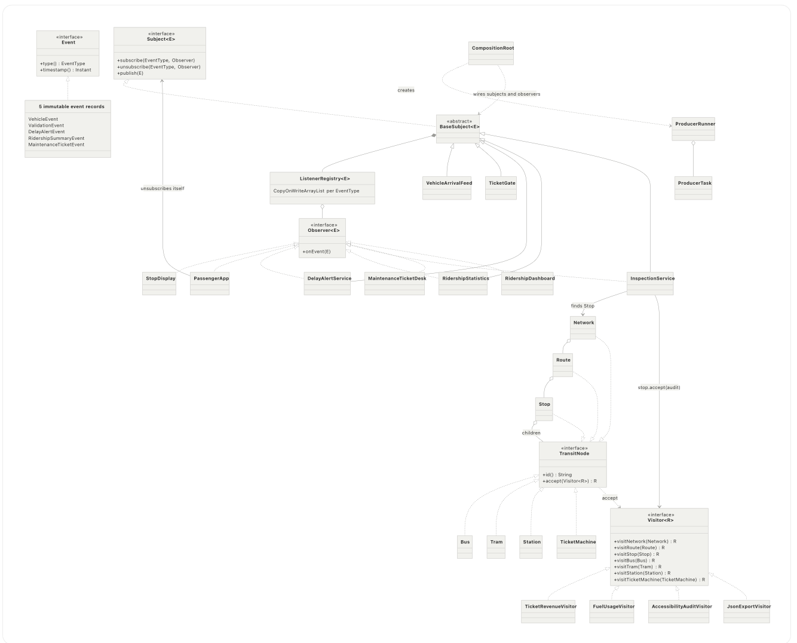

# Assignment 6 – Observer and Visitor Patterns

**Variant 15 – Public transport**

Student: Khanzada Nyshanbek, group SE-2539
## 1. Overview

A live data source notifies subscribers (**Observer**) and new operations are added to a stable object tree (**Visitor**).

* **Observer side:** vehicle arrivals and ticket validations → stop displays, passenger app, delay alerts, ridership statistics (as required by the variant), plus an inspection service, a maintenance desk and a dashboard.
* **Visitor side:** `Network → Route → Stop → buses, trams, stations, ticket machines` with visitors for ticket revenue, fuel, accessibility audit and JSON export.
* **Integration:** a delay alert starts an audit visitor on the affected stop only, and the result goes back into the system as a maintenance ticket: `alert → inspection → maintenance ticket`.

## 2. Build, test and run

```bash
mvn test
mvn compile
java -cp target/classes transit.app.Main 4
```

The argument of `Main` is the number of producer threads (default 4).

## 3. Requirements checklist

| # | Requirement | Where it is fulfilled |
|---|---|---|
| 1 | ≥ 2 subjects, ≥ 5 listeners, own generic `Subject`/`Observer` | 2 sources (`VehicleArrivalFeed`, `TicketGate`), 7 listeners, `Subject<E>`, `Observer<E>` (section 4) |
| 1 | Immutable events with a type | 5 records implementing `Event`, `EventType` enum |
| 1 | Listeners subscribe per event type | `subscribe(EventType, Observer)` |
| 1 | Join/leave at runtime, also from inside own handler | `PassengerApp`, `ListenerRegistry`, tests in `ObserverMechanicsTest`, `ConcurrencyTest` |
| 1 | A listener that is also a subject (chain) | `DelayAlertService`, `RidershipStatistics`, `InspectionService` |
| 1 | Push or pull, justified | push, section 4.3 |
| 2 | Composite tree ≥ 3 levels, 2 container types, 4 leaf types | 3 container types (`Network`, `Route`, `Stop`), 4 leaf types (section 5) |
| 2 | `Visitor<R>`, double dispatch, ≥ 4 visitors (numeric, accumulating, filter, JSON/XML) | `TicketRevenueVisitor`, `FuelUsageVisitor`, `AccessibilityAuditVisitor`, `JsonExportVisitor` |
| 2 | Who traverses, justified; elements hold data only | the visitor traverses, section 5.3 |
| 3 | Observer event triggers a visitor on the related subtree only; result goes back as an event | `InspectionService` (section 6) |
| 4 | ≥ 3 producer threads on an `ExecutorService`, configurable thread count | `ProducerRunner`, `SystemConfig`, `Main` (section 7) |
| 4 | Thread-safe registry and shared state without locking the whole subject | copy-on-write registry, atomics, concurrent maps, immutable data |
| 4 | Graceful shutdown, no lost events, no hanging threads | `ProducerRunner`, synchronous notification, tests |
| 5 | One composition root, constructor injection only, no lazy initialization | `CompositionRoot` (+ `Main`), section 8 |
| 5 | No duplication, clear names, no interface/class without a reason | section 8 |
| 6 | Two separate commits: new visitor without touching elements, new element type | section 9 |
| 7 | ≥ 15 JUnit tests incl. stress test 4 × 1,000 with exact count, visitor results vs hand-calculated values | 36 tests, section 10 |
| 7 | README, one UML class diagram, meaningful commit history | section 11 and the Git history of the repository |
| – | Not used: `java.util.Observable`, event-bus libraries, lecture examples with renamed classes | confirmed; only the JDK and JUnit 5 are used |

## 4. Observer side

### 4.1 Data sources and listeners

| Subject (source) | Events | Listeners |
|---|---|---|
| `VehicleArrivalFeed` | `ARRIVAL`, `DEPARTURE` (`VehicleEvent`) | `StopDisplay` (one per stop), `PassengerApp`, `DelayAlertService` |
| `TicketGate` | `TICKET_VALIDATION` (`ValidationEvent`) | `RidershipStatistics` |
| `DelayAlertService` (listener and subject) | `DELAY_ALERT` (`DelayAlertEvent`) | `InspectionService` |
| `RidershipStatistics` (listener and subject) | `RIDERSHIP_SUMMARY` (`RidershipSummaryEvent`) | `RidershipDashboard` |
| `InspectionService` (listener and subject) | `MAINTENANCE_TICKET` (`MaintenanceTicketEvent`) | `MaintenanceTicketDesk` |

Chains of observers:

```
arrivals ─ARRIVAL─► DelayAlertService ─DELAY_ALERT─► InspectionService ─MAINTENANCE_TICKET─► MaintenanceTicketDesk
ticket gate ─TICKET_VALIDATION─► RidershipStatistics ─RIDERSHIP_SUMMARY─► RidershipDashboard
```

* `StopDisplay` keeps the vehicles currently standing at its stop (arrival adds, departure removes).
* `PassengerApp` waits for one route at one stop, notifies the passenger once and **unsubscribes itself inside its own handler**.
* `DelayAlertService` raises an alert when the delay is greater than or equal to the configured threshold.
* `RidershipStatistics` counts passengers per route and republishes an aggregated summary after every N passengers.

### 4.2 Generic interfaces and events

* `Subject<E extends Event>`: `subscribe(EventType, Observer<? super E>)`, `unsubscribe(...)`, `publish(E)`.
* `Observer<E extends Event>`: `onEvent(E)`.
* `Event`: `type()` and `timestamp()`. All events are records (immutable, validated in the constructor, lists copied with `List.copyOf`).
* `BaseSubject<E>` contains the subscription and notification code once. A listener that throws is logged and skipped, so it cannot block the other listeners.

### 4.3 Push or pull: push

The event carries all data the listener needs (vehicle, route, stop, delay, timestamp). Reasons:

1. Events are immutable, so a listener never reads half-updated state of the source while another thread changes it.
2. With pull, every listener would need a reference to the subject and call getters, which couples it to the subject and opens a gap between "notified" and "read" in which the state can change.
3. The payload is small, so pushing all fields is cheap.

Cost of push: all listeners get all fields, even those they ignore.

### 4.4 Runtime join/leave and thread safety of the registry

`ListenerRegistry` keeps one `CopyOnWriteArrayList` per `EventType` in a `ConcurrentHashMap`.

* Iteration works on a snapshot, so a listener can unsubscribe from inside its own handler without `ConcurrentModificationException`, and a listener that joins during a notification starts with the next event.
* Publishing never blocks subscribing and there is no lock around the subject. Writes (subscribe/unsubscribe) are rare and reads (publish) are frequent, which fits copy-on-write.
* Subscribing the same observer twice for one type is ignored (`addIfAbsent`).

## 5. Visitor side

### 5.1 Tree

```
Network (container)
 └─ Route (container)
     └─ Stop (container)
         ├─ Bus            (leaf)
         ├─ Tram           (leaf)
         ├─ Station        (leaf)
         └─ TicketMachine  (leaf)
```

The tree has 4 levels with 3 container types. Elements are immutable records with data only; their only method is `accept`, which calls the matching visitor method. Containers copy their child lists with `List.copyOf`, so the tree is immutable and safe to share between threads.

### 5.2 Double dispatch

`Visitor<R>` has one method per element type. In `node.accept(visitor)` the element is chosen at runtime (first dispatch) and calls `visitor.visitBus(this)` (the method is fixed at compile time because `this` is a `Bus`), and the visitor's own class decides the behaviour (second dispatch). If the client called `visitor.visit(node)` with a `TransitNode` variable, Java would choose the overload at compile time from the static type and could not call `visitBus` or `visitTram` for the real element.

### 5.3 Who traverses: the visitor

Container `accept` methods are one line. Each visitor walks `children()` itself. Reasons:

* Element classes stay data-only, as required.
* Visitors need different traversal behaviour: `FuelUsageVisitor` remembers the current route, `AccessibilityAuditVisitor` checks the stop before its children, `JsonExportVisitor` builds nested text.
* A visitor can also be started on any subtree (used by the integration).

Cost: a small loop is repeated in each visitor.

### 5.4 Visitors

| Visitor | `R` | Kind | Result |
|---|---|---|---|
| `TicketRevenueVisitor` | `Double` | numeric calculation, stateless | total daily ticket revenue of a subtree |
| `FuelUsageVisitor` | `Void` | accumulates state across the whole tree | litres of diesel, kWh of electricity, cost per route (new instance per traversal) |
| `AccessibilityAuditVisitor` | `List<TransitNode>` | filter | all non-accessible elements in traversal order |
| `JsonExportVisitor` | `String` | hand-written JSON | correct nesting, indentation and string escaping |

## 6. Integration (Observer → Visitor → Observer)

1. A vehicle arrives late → `DelayAlertService` publishes a `DelayAlertEvent`.
2. `InspectionService` receives it, finds the affected `Stop` and calls `stop.accept(audit)`. The visitor runs **only on that stop's subtree**, not on the route or the network.
3. If the audit returns elements, `InspectionService` publishes a `MaintenanceTicketEvent` with their ids.
4. `MaintenanceTicketDesk` stores the ticket.

The audit visitor is injected through the constructor (`Visitor<List<TransitNode>>`), so `InspectionService` does not know the concrete visitor.

## 7. Concurrency (Clean Code ch. 13)

* `ProducerTask` is one producer job; `ProducerRunner` runs several tasks on an injected `ExecutorService`. The thread count is configurable (`SystemConfig.producerThreads`, argument of `Main`). `Main` starts 4 producers, the stress tests use 4 threads.
* **No lock around the subject:** the registry is copy-on-write, counters are `AtomicLong`/`LongAdder`, shared maps are `ConcurrentHashMap`, the tree and the events are immutable.
* **Exact counting:** `RidershipStatistics` uses `incrementAndGet()`, so each thread gets a unique number and every batch boundary is published exactly once.
* **No lost events:** notification is synchronous in the producing thread. When a task ends, all its events have been delivered to all listeners.
* **Graceful shutdown:** `ProducerRunner` calls `shutdown()`, waits with `awaitTermination(timeout)`, and only after the timeout calls `shutdownNow()` and throws. A failure of any producer is rethrown through `Future.get()`. Tests show that the pool terminates after a normal run, after a failing producer and after a hanging producer.

## 8. Clean Code (ch. 11–12)

* **One composition root:** `CompositionRoot.assemble(...)` creates and wires all objects (`Main` only builds demo data and starts the producers). Nothing else uses `new` for collaborators.
* **Constructor injection only:** clock, network, audit visitor, executor, thresholds and the feed in `PassengerApp` are all passed through constructors. No setters, no singletons, no static mutable state.
* **No lazy initialization in business code:** all dependencies are created eagerly in the composition root. (`computeIfAbsent` in the registry and the statistics only creates an entry of a map for a new key; it is not lazy initialization of a dependency.)
* **No duplication:** subscription/notification logic is only in `BaseSubject`; producer loops only in `ProducerTask`; the traversal helper is one small method in each visitor.
* **Every interface or class has a reason:**

| Type | Reason |
|---|---|
| `Event` | common contract for the generic `Subject`/`Observer` |
| `Subject`, `Observer` | the Observer pattern; the subject depends only on this interface |
| `BaseSubject` | shared subscription/notification code for 5 subjects |
| `ListenerRegistry` | thread-safe storage of listeners, separated from notification |
| `TransitNode` | common type of tree elements with `accept` |
| `Visitor` | the Visitor pattern |
| `ProducerTask` | removes duplicated producer loops |
| `ProducerRunner` | graceful shutdown in one place |
| `SystemConfig`, `TransitSystem` | configuration and the wired application as plain data |

## 9. Trade-off proof: two separate commits

Both commits are stored in `trade-off-patches/` and were applied one after another.

### Commit A: new visitor `CapacityVisitor`, no element class touched

| File | Change |
|---|---|
| `src/main/java/transit/visitor/CapacityVisitor.java` | new |
| `src/test/java/transit/CapacityVisitorTest.java` | new |

Cost: 2 files, no existing file modified. This is the case Visitor is built for.

### Commit B: new element type `Trolleybus`

| File | Change |
|---|---|
| `src/main/java/transit/model/Trolleybus.java` | new |
| `src/main/java/transit/visitor/Visitor.java` | new method `visitTrolleybus` |
| `src/main/java/transit/visitor/TicketRevenueVisitor.java` | new method |
| `src/main/java/transit/visitor/FuelUsageVisitor.java` | new method |
| `src/main/java/transit/visitor/AccessibilityAuditVisitor.java` | new method |
| `src/main/java/transit/visitor/JsonExportVisitor.java` | new method |
| `src/main/java/transit/visitor/CapacityVisitor.java` | new method |
| `src/test/java/transit/TrolleybusVisitorTest.java` | new |

Cost: one new class, the `Visitor` interface and **every** visitor, which is `2 + V` production files for V visitors (V = 5 here). The compiler forces every visitor to be updated, so nothing is forgotten, but the cost grows with every visitor.

**When I would reject Visitor:** when new element types appear often and there are many visitors, because each new element touches all of them. Visitor pays off when the tree is stable and operations change, as here: the vehicle types rarely change, but new reports (revenue, capacity, audits, exports) are requested all the time.

## 10. Tests (36)

| Class | Tests | What is checked |
|---|---|---|
| `ObserverMechanicsTest` | 8 | delivery of immutable events, subscription per type, unsubscribe, leaving and joining inside a handler, failing listener, duplicate subscription, event validation |
| `ListenerTest` | 5 | stop display, passenger app (notifies once and unsubscribes itself), delay threshold boundary, ridership batches, dashboard |
| `IntegrationTest` | 4 | alert → audit of the related subtree only → ticket; no ticket below the threshold, for an unknown stop or for an accessible subtree |
| `VisitorTest` | 10 | revenue, fuel/kWh/cost, audit list and order, exact JSON text, escaping, double dispatch, immutability of the tree |
| `ConcurrencyTest` | 7 | stress 4 × 1,000 validations (exact counts), stress 4 × 1,000 arrivals (exact alerts and tickets), subscribe/unsubscribe while publishing, self-unsubscribe under load, graceful shutdown, failing and hanging producers |
| `CapacityVisitorTest`, `TrolleybusVisitorTest` | 2 | the two trade-off commits |

**Hand-calculated visitor values** (`TestData`): `B1` = 10 L/100 km × 100 km = 10 L; `T1` = 200 kWh/100 km × 50 km = 100 kWh; `B2` = 20 L/100 km × 50 km = 10 L. Revenue: 1000 + 2000 + 500 + 1500 = 5000. With 100 per litre and 10 per kWh: route R1 = 10·100 + 100·10 = 2000, route R2 = 10·100 = 1000, total 3000. Capacity: 50 + 100 + 40 = 190.

**Stress test:** 4 threads × 1,000 validations → exactly 4,000 passengers, dashboard value 4,000 and exactly 40 summaries (batch size 100).

## 11. UML class diagram



## 12. Known limitations

* Notification is synchronous, so a slow listener slows the producing thread. An asynchronous queue per listener would decouple them, but synchronous delivery gives "no lost events" for free.
* Listeners of one event type are notified in subscription order, but the design must not rely on this order.
* Vehicles are modelled as children of the stop they are assigned to, as in the variant's tree.